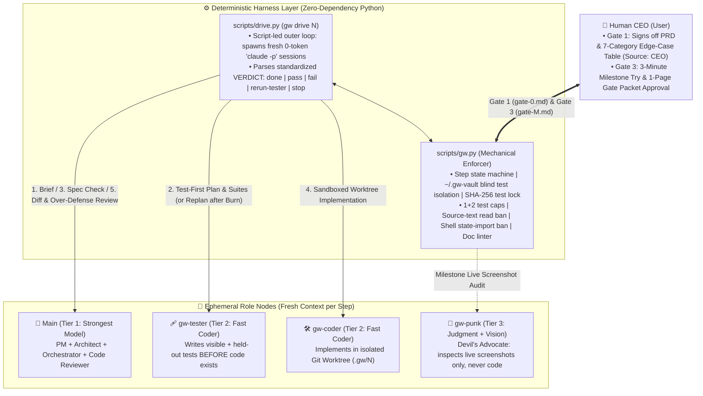

# graph-workflow (`gw`)

[](LICENSE)
[-green.svg)](scripts/gw.py)
[](CHANGELOG.md)
[](SKILL.md)

**A deterministic, test-first, anti-slop graph workflow for building real software products with AI coding agents.**

Most multi-agent coding frameworks fail on multi-milestone software builds for the exact same reasons: **information dies at PM-to-Architect hand-offs**, **agents decide ambiguous edge cases silently**, **coders smuggle in hundreds of lines of defensive scaffolding**, **models peek at or overfit to visible tests**, and **rules written in prompt prose lose to heavy-RL model habits**.

`graph-workflow` (`gw`) solves this by combining a **minimal 4-role graph topology** (`Main`, `Coder`, `Tester`, `Punk`) with a **zero-dependency Python deterministic state machine (`scripts/gw.py`)** and a **headless script-led orchestrator (`scripts/drive.py`)**.

---

## Why `graph-workflow`? (Five Observations from Real Builds)

1. **One Brain for Planning & Architecture (`Main`)**: Splitting PM, Architect, Orchestrator, and Reviewer into separate chatting agents destroys context at every hand-off. In `gw`, **Main** is a single role chain; subagents are spawned *only* when fresh eyes (`gw-tester`, `gw-punk`), worktree isolation (`gw-coder`), or context protection are needed.
2. **Models Decide Ambiguous Cases Silently (`Gate 1 Edge-Case Sweep`)**: In our 4-way benchmark (*Flow Timer*, see [research-notes.md §11](research-notes.md)), every single-agent and multi-agent build silently settled 4 planted product edge cases without asking the human—and chose differently. `gw gate 1` enforces a structured 7-category edge-case sweep that physically blocks task creation until every disputed row has `Source: CEO`.
3. **Prompts Lower Over-Defense; Code & Audits Remove It**: Coding models compulsively add unrequested state flags, version counters, retry wrappers, and triple resets. `gw` forces the Coder to declare every guard in a `## Defenses added` table and subjects every diff to a strict Over-Defense Audit.
4. **A Builder Cannot See Its Own UX (`gw-punk`)**: Single-agent builds shipped **6 out of 6** common UX faults (missing destructive confirmation, invisible tab-title state, low WCAG contrast, broken focus traps, `<44px` touch targets, lost state on reload)—even when the agent took its own screenshots. `gw-punk` never reads source code; it inspects only the PRD and live screenshots against an enforced `Always check` list.
5. **Rules in Prose Lose to Model Habits; Rules in Code Do Not (`gw.py`)**: Instead of begging an LLM in Markdown not to edit tests, touch out-of-scope files, or write 24,000 words of documentation bloat, `scripts/gw.py` enforces step order, SHA-256 test locks, file whitelists, held-out test vaults, test-count caps, and document budgets mechanically.

---

## Architecture & Team Topology

**Edges are typed documents with strict budgets—never free-form chat.** State lives in Git (`docs/workflow/`), never in volatile chat memory.



### The Roles

| Role | Who | Model Tier | Sees | Produces |
| :--- | :--- | :--- | :--- | :--- |
| **Main** | Primary session (or headless judge via `gw drive`) | **Strongest** | Everything in main checkout | `PRD.md` (with Edge cases), `architecture.md`, `tasks.md`, `brief-N.md`, reviews, `gate-M.md` |
| **Tester** | Subagent [`gw-tester`](agents/gw-tester.md) | **Fast coder** | `brief-N.md` + test conventions (*before* code exists) | `visible/` tests, `holdout/` tests, `test-plan-N.md` (with ambiguity probes) |
| **Coder** | Subagent [`gw-coder`](agents/gw-coder.md) | **Fast coder** | Isolated worktree `<repo>.gw/N/`: brief, allowed files, `visible/` tests | Implementation code + `handoff-N.md` (with `## Defenses added`) |
| **Punk** | Subagent [`gw-punk`](agents/gw-punk.md) | **Judgment + Vision** | `PRD.md` + running product screenshots (*never* source code) | Ranked UX/product objections (`objections-M.md` ≤ 1 page) + annotated screens |
| **`gw.py`** | [`scripts/gw.py`](scripts/gw.py) | **Python stdlib** | Main repo, worktrees, `~/.gw-vault/` | Mechanical refusals, gate validations, test runs, merges, audit logs |

---

## How `graph-workflow` Compares to Existing Open-Source Workflows

| Dimension | **Code-First SDK Graphs** (*LangGraph, CrewAI, AutoGen, MetaGPT*) | **Prompt-Only Skills** (*BMAD-METHOD, Superpowers, Spec-Kit, ccpm*) | **`graph-workflow` (v0.5)** |
| :--- | :--- | :--- | :--- |
| **Execution Engine** | Custom API wrappers (loses native Claude Code CLI capabilities) | Pure Markdown prompts (relies on LLM self-discipline) | **Claude Code CLI + Deterministic Python State Machine (`gw.py` + `drive.py`)** |
| **Role Topology** | Separate PM, Architect, Tech Lead nodes (high hand-off loss) | Heavy agile ceremonies (Analyst → PM → Scrum Master → Dev) | **Single-Brain `Main` (PM+Arch+Review) + 3 Blind/Isolated Subagents** |
| **Anti-Test-Cheating** | None (shared context or transparent tests) | Prompt-guided TDD (Coder sees all tests and can edit assertions) | **Test-First + `~/.gw-vault` Isolation + SHA-256 Lock + Single-Use `gw burn`** |
| **Silent Edge Decisions** | Unstructured HITL interrupts | Optional `/clarify` prompts | **Mandatory 7-Category Edge Sweep (`gw gate 1` blocks until `Source: CEO`)** |
| **Anti-Slop / Over-Defense** | Unchecked defensive bloat | Unchecked defensive bloat | **Mandatory `## Defenses added` table + 3-Question Over-Defense Audit** |
| **UI / Glue Layer Testing** | Fragile DOM mocks or zero coverage | Unspecified | **Headless State Machine (`step(state, event) -> (state, effects)`) + `gw-punk`** |
| **Doc Bloat Control** | Unbounded logs | Often generates 20,000+ words of Epics/Stories | **Enforced Binary Doc Linter (`gw docs`): Record (tables only) vs Thinking (≤3 sentences)** |
| **Coordination Tax** | Accumulating state history | Massive main-session context growth (400k+ tokens) | **`gw drive`: Fresh 0-token `claude -p` session per step + `gw finish` atomic command** |

---

## Key Mechanisms in v0.5

### 1. Gate 1: Seven-Category Edge-Case Sweep (`gw gate 1`)

Before a single task brief can be written, Main sweeps every requirement in `PRD.md` across 7 mandatory edge-case categories:

- `threshold` (at/just below boundary)
- `interleave` (action B while A is in progress)
- `repeat` (double-click, rapid re-entry)
- `time-cross` (crossing zero, grace periods)
- `counting` (what counts toward a tally)
- `environment` (reload, midnight rollover, background tab throttling)
- `failure` (corrupt storage, missing asset)

Undisputed categories get a single `- No dispute: <category>` line (avoiding Cartesian product fatigue). Disputed cases become rows in `## Edge cases` (`E1`, `E2`...) where **the human CEO must fill the `Decision` column (`Source: CEO`)**. `gw gate 1` mechanically blocks `gw brief N` until every category is accounted for and every decision is signed off by the CEO.

### 2. Blind Held-Out Vault & Single-Use Burn (`gw seal`, `gw holdout`, `gw burn`)

- **Test-First**: `gw-tester` writes `visible/` and `holdout/` suites *before* `gw-coder` sees the task.
- **Test Caps & Source-Text Ban**: `gw planned N` statically counts test definitions (`it(`, `def test_`, `#[test]`, `func Test`) and enforces at most **1 visible + 2 held-out tests** per criterion/edge row. It also blocks any test that reads product source files (`src/`) as text strings.
- **Vault Isolation & Single-Use Burn**: `gw seal N` moves `holdout/` into `~/.gw-vault/`. If a Coder passes `visible/` tests and Main's code review but fails `gw holdout N`, **that held-out set is considered leaked (`gw burn N`)**: it is permanently moved into `visible/` for the Coder to debug, and `gw-tester` is invoked to write a brand-new unseen held-out set (`set + 1`).

### 3. Orchestration as a Headless State Machine

UI, native window lifecycles, and timer/sync glue are notoriously hard to unit-test. When a task's risk layer is `orchestration`, `gw` enforces a strict functional split:

- **Pure Core**: `step(state, event) -> (state, effects)` where `state`, `event`, and `effects` are plain data enums, and time arrives strictly as an event (`Tick(now)`). `gw-tester` blasts the core with reordered, duplicated, and interleaved event sequences.
- **Imperative Shell**: Translates OS/DOM facts into events and executes effects 1-to-1. **Shell files may never import the state type**—enforced mechanically by `gw check` via `shell_paths` and `shell_forbid` regex rules. The shell is verified visually by `gw-punk` and the CEO.

### 4. Script-Led Orchestration Inversion (`gw drive N`)

In persistent chat sessions, the orchestrator's context window balloons (from 79k to 410k tokens in our benchmark, burning 40.7M cached read tokens). `scripts/drive.py` inverts control:

```bash
python scripts/gw.py drive 1
```

`drive.py` runs as an external zero-token state loop, spawning fresh headless `claude -p --output-format json` sessions for each step (`brief` → `tester` → `spec-check` → `coder` → `review` → `finish`), feeding each session only the exact file paths it needs and parsing Main's single-line `VERDICT: done | pass | fail | rerun-tester | stop`.

---

## Real-World Benchmark: The 4-Way *Flow Timer* Experiment

In [research-notes.md §11](research-notes.md), we tested `graph-workflow` against unadorned single-agent builds on *Flow Timer* (a focus timer with idle detection and 4 planted spec ambiguities):

| Metric | `graph-workflow` (Claude Code) | Single Agent (Claude) | Single Agent (Codex) | What v0.5 Added to Fix the Gap |
| :--- | :--- | :--- | :--- | :--- |
| **Planted Edge Probes Locked by Tests** | **4 / 4 (100%)** | 2 / 4 (50%) | 2 / 4 (50%) | Mandatory `E#` test naming & source-read ban |
| **6 Common UX Faults Shipped** | **0 / 6 (0% escaped)** | **6 / 6 (100% escaped)** | **6 / 6 (100% escaped)** | Codified into `gw-punk` `## Always check` |
| **Planted Probes Surfaced to CEO** | 0 / 4 (decided silently) | 0 / 4 | 0 / 4 | **`gw gate 1` 7-Category CEO Edge Sweep** |
| **Orchestrator Cache Read Tokens** | 40.7M (410k peak context) | 4.5M | 1.1M | **`gw drive` zero-history headless sessions + `gw finish`** |
| **Test : Production Code Ratio** | 5 : 1 (192 unit tests) | 0.8 : 1 (49 tests) | 0.9 : 1 (36 tests) | **`test_caps` (`1 visible + 2 holdout` per item)** |

---

## Quick Start & Installation

### 1. Install the Skill (Outside Your Product Repo)
>
> **Important:** Install `graph-workflow` in your personal skills directory (e.g., `~/.claude/skills/graph-workflow`), **never inside the product repository**, so subagents cannot read the skill internals or discover where held-out vaults live.

```bash
git clone https://github.com/<your-org>/graph-workflow.git ~/.claude/skills/graph-workflow
```

### 2. Initialize Inside Your Product Repository

From your product repository's root (must be a Git repo, preferably off cloud-synced drives):

```bash
# 1. Initialize docs/workflow/, gw.json, and sibling folders (<repo>.gw/ and <repo>.tests/)
python ~/.claude/skills/graph-workflow/scripts/gw.py init

# 2. Copy the 7 long-lived templates into docs/workflow/
cp ~/.claude/skills/graph-workflow/templates/{PRD,STATE,architecture,tasks,decisions,debt,log}.md docs/workflow/

# 3. Copy the 3 subagent definitions into your project's Claude Code agents folder
mkdir -p .claude/agents
cp ~/.claude/skills/graph-workflow/agents/gw-{coder,tester,punk}.md .claude/agents/
```

### 3. Configure `docs/workflow/gw.json`

Edit `docs/workflow/gw.json` to match your stack's test runner, source directories, and headless state-machine boundaries:

```json
{
  "test_command": "npm test",
  "test_dir": "tests",
  "setup_command": "npm ci --prefer-offline",
  "registry_files": ["package.json", "src/index.ts"],
  "shell_paths": ["src/shell/**"],
  "shell_forbid": ["from ['\"].*state", "import.*State"],
  "parallel_max": 2,
  "port_base": 4100,
  "edge_categories": ["threshold", "interleave", "repeat", "time-cross", "counting", "environment", "failure"],
  "test_caps": { "visible": 1, "holdout": 2 },
  "source_dirs": ["src"],
  "screens_max": 12
}
```

### 4. Run the Workflow

```text
<parent>/
├── <repo>/                           # Main checkout (Main works here)
│   └── docs/workflow/
│       ├── STATE.md  PRD.md  tasks.md  decisions.md  debt.md  log.md
│       ├── architecture.md           # Index; details in architecture/<component>.md
│       ├── gw.json                   # Deterministic gate & drive config
│       ├── briefs/  handoffs/  tests/  gates/  punk/  archive/
├── <repo>.gw/N/                      # Isolated git worktree per active task (Coder works here)
└── <repo>.tests/N/                   # Staging area before held-out tests are sealed into ~/.gw-vault/
```

#### CLI Command Reference (`scripts/gw.py`)

| Command | Phase | Description |
| :--- | :--- | :--- |
| `gw init` | Setup | Creates `docs/workflow/gw.json`, `.gitignore` rules, and sibling worktree/test directories |
| `gw status` / `gw next` | Any | Prints active task states, slots, and the exact next deterministic command |
| `gw gate 1` | Phase A | Validates PRD `## Edge cases` (all 7 categories covered, all rows `Source: CEO`) and unlocks `gw brief` |
| `gw brief N` | Phase B | Checks `brief-N.md` sections, risk layer, word budget, and verbatim PRD edge rows |
| `gw planned N` | Phase B | Validates `visible/`, `holdout/`, `test-plan.md`, enforces `1+2` test caps, `E#` naming, and no source-text reads |
| `gw seal N` | Phase B | Verifies brief is committed on `main` and seals `holdout/` into `~/.gw-vault/` |
| `gw open N` | Phase B | Allocates `GW_SLOT`, creates git worktree `<repo>.gw/N`, runs setup, and copies `visible/` tests |
| `gw check N` | Phase B | Verifies file whitelist, unmodified `visible/` hashes, untouched `registry_files`, `shell_forbid`, and `handoff-N.md` |
| `gw finish N` | Phase B | **Atomic compound call**: `review pass` → `holdout` → `merge` (with main refresh/drift check) → `close` |
| `gw burn N` | Phase B | Converts a failed `holdout/` set into `visible/` and sends task back to `replan` for a fresh held-out suite |
| `gw drive [N...]` | Phase B | Runs the headless `claude -p` script-led loop for task `N` (or all unblocked tasks in `tasks.md`) |
| `gw gate 3 M<n>` | Phase C | Verifies all milestone tasks closed, zero `Main provisional` edge rows left, Punk report/screens within cap, and clean `gw docs` |
| `gw archive M<n>` | Phase C | Moves finished milestone artifacts into cold storage (`docs/workflow/archive/M<n>/`) |
| `gw docs` | Any | Lints all workflow documents against Record (tables-only) and Thinking (≤3 sentences/heading, ≤40 words/bullet) budgets |

---

## Repository Contents

- [`SKILL.md`](SKILL.md) — Core workflow specification and instructions for `Main`.
- [`scripts/gw.py`](scripts/gw.py) — Zero-dependency Python deterministic state machine, linter, test-vault manager, and worktree harness.
- [`scripts/drive.py`](scripts/drive.py) & [`references/drive.md`](references/drive.md) — Headless `claude -p` orchestrator (`gw drive`).
- [`agents/`](agents/) — Subagent prompts for [`gw-coder.md`](agents/gw-coder.md), [`gw-tester.md`](agents/gw-tester.md), and [`gw-punk.md`](agents/gw-punk.md).
- [`templates/`](templates/) — Strict, budget-compliant templates for `PRD`, `architecture`, `tasks`, `STATE`, `brief`, `handoff`, `test-plan`, `test-report`, `objections`, `gate`, `decisions`, `debt`, and `log`.
- [`references/failure-checklist.md`](references/failure-checklist.md) — Pre-gate verification checklist distilled from MAST and empirical runs.
- [`research-notes.md`](research-notes.md) & [`CHANGELOG.md`](CHANGELOG.md) — Complete literature review, empirical post-mortems (v0.1 → v0.5), and benchmark numbers.

---

## License

Released under the [MIT License](LICENSE).
