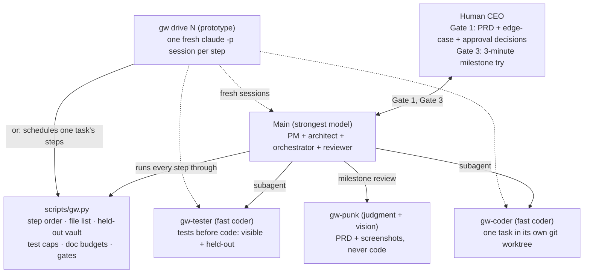

# graph-workflow (`gw`)

[](LICENSE)
[-green.svg)](scripts/gw.py)
[](CHANGELOG.md)
[中文版](README.zh-CN.md)

**A test-first graph workflow for building software with AI coding agents, where everything mechanical is enforced by a script instead of a prompt.**

## TL;DR

Multi-agent coding setups tend to fail in the same few ways: information is lost at hand-offs between PM and architect roles, agents settle ambiguous product questions without asking, coders add defensive scaffolding nobody asked for, tests end up shaped by the implementation they should be checking, and rules written in prompt prose give way to a model's trained habits.

`graph-workflow` answers with a **four-role graph** (`Main`, `Coder`, `Tester`, `Punk`) plus a **standard-library Python script** (`scripts/gw.py`) that enforces step order, gates and mechanical checks, and a **script-led orchestrator** (`gw drive`) that keeps every step in a fresh session.

It works — proven on one benchmark and one real three-milestone project — and it is not cheap: about ten times the time and five times the test volume of a single agent on a small build. Read [When not to use it](#when-not-to-use-it) before you adopt it.

> **Status: v0.7, experimental.** The fixes in v0.7 came out of the first real project (research-notes §12); they have not yet been re-run end to end on another full project.

## Contents

- [When not to use it](#when-not-to-use-it)
- [Team and topology](#team-and-topology)
- [Five observations from real builds](#five-observations-from-real-builds)
- [Design choices](#design-choices)
- [Key mechanisms](#key-mechanisms)
- [Real runs](#real-runs)
- [Requirements](#requirements)
- [Quick start](#quick-start)
- [Commands (`scripts/gw.py`)](#commands-scriptsgwpy)
- [Repository contents](#repository-contents)
- [Related documents](#related-documents)
- [License](#license)

## When not to use it

- **Small or one-screen projects.** On Flow Timer a single agent was about ten times cheaper and equally correct. If you only take two things from this repo, take the Gate 1 edge-case sweep and a Punk pass.
- **Fewer than three files and no design decision.** Do it directly; the skill says so too (Scaling → Down).
- **No Git.** `gw` needs it. A manual fallback is described in `SKILL.md`, but nothing is enforced.

## Team and topology

Edges are files with page budgets, never free-form chat. State lives in Git under `docs/workflow/`.



| Role | Who | Model tier | Sees | Produces |
| :--- | :--- | :--- | :--- | :--- |
| **Main** | your session (or one fresh session per step under `gw drive`) | strongest | everything in the main checkout | `PRD.md` with edge cases and approvals, `architecture.md`, `tasks.md`, briefs, reviews, gate packets |
| **Tester** | subagent [`gw-tester`](agents/gw-tester.md) | fast coder | the brief and test conventions, before any code exists | visible tests, held-out tests, a test plan with an ambiguity list |
| **Coder** | subagent [`gw-coder`](agents/gw-coder.md) | fast coder | its worktree `<repo>.gw/N/`: brief, allowed files, visible tests | code + `handoff-N.md` with `## Defenses added` |
| **Punk** | subagent [`gw-punk`](agents/gw-punk.md) | judgment + vision | `PRD.md` and the running product in the browser pane (it takes its own screenshots), never source | up to five ranked objections (`objections-M.md`, 350 words) |
| **gw.py** | [`scripts/gw.py`](scripts/gw.py) | none | main checkout, worktrees, `~/.gw-vault/` | refusals, gate results, test runs, merges, log lines |

Tiers name kinds of model, not a ranking. Pick models per installation; a second model family is best spent on the Tester or Punk.

## Five observations from real builds

1. **Keep planning in one brain.** PM, architect, orchestrator and reviewer are one role, `Main`, running in one session. Subagents exist only for fresh eyes (`gw-tester`, `gw-punk`), for worktree isolation and parallel work (`gw-coder`), and to keep Main's context small on large projects.
2. **Models decide ambiguous cases silently.** In the four-build *Flow Timer* benchmark ([research-notes](research-notes.md)), every build, this workflow included, settled four planted edge cases without asking the human. They happened to agree on those four, but split on two other undisclosed choices. `gw gate 1` now blocks task briefs until a seven-category edge-case table carries the human's decision on every disputed row.
3. **Prompts lower over-defense; review removes it.** Coding models add unrequested state flags, version counters, retries and repeated resets. The Coder must list every guard under `## Defenses added`, and Main's review deletes any guard that names no failure.
4. **A builder does not see its own UX.** Both single-agent builds shipped all six of a set of common UX faults: a destructive action with no confirmation, no state in the tab title, text contrast below WCAG AA, focus not moved to a banner that appears, touch targets under 44 px, and work lost on reload. One of them had taken its own screenshots. `gw-punk` never reads code; it checks the PRD and live screenshots against an `Always check` list.
5. **Rules in prose lose to model habits; rules in code do not.** `gw.py` enforces step order, the Coder's file list, byte-identical visible tests, the held-out vault, test-count caps, document budgets, commit-hook rehearsals and review grounds mechanically.

## Design choices

Compared with what multi-agent frameworks (LangGraph, CrewAI, AutoGen, MetaGPT) and prompt-only workflow skills (BMAD-METHOD, Superpowers, Spec-Kit) commonly do. Each project differs, so check its current docs.

| Concern | Common approach | `graph-workflow` |
| :--- | :--- | :--- |
| Who enforces the process | the model, following prompts; or your own agent loop over model APIs | a coding-agent CLI plus `gw.py`, which refuses out-of-order or out-of-scope steps |
| Role split | separate PM, architect, lead and developer agents | one `Main` for planning and review; three narrow subagents |
| Tests the Coder can game | the coder sees or edits the whole suite | tests written first; held-out sets kept outside the repo; each set used once (`gw burn`) |
| Ambiguous product decisions | an optional clarification step | a mandatory edge-case table and an approvals table; `gw gate 1` blocks briefs until the human decides |
| Defensive bloat | left to review | `## Defenses added` table plus an over-defense audit in review |
| UI and glue code | DOM mocks, or no tests | a pure `step(state, event) -> (state, effects)` core plus a thin shell checked by Punk |
| Documentation volume | unbounded | `gw docs`: record files tables only, thinking files ≤ 3 sentences per heading, word budgets (brief 350, handoff 150), three rows per handoff table |
| Orchestrator context | grows for the whole build | one task per session; `gw drive` starts each step fresh |

## Key mechanisms

### 1. Gate 1: edge cases and approvals decided before any code

Before any task brief, Main goes through every PRD requirement against seven categories (`edge_categories` in `gw.json`):

| Category | Asks |
| :--- | :--- |
| `threshold` | exactly at, just under, too little left |
| `interleave` | another action arrives mid-state: does the count carry on |
| `repeat` | the same action twice fast, two sources at once |
| `time-cross` | a window crosses another deadline |
| `counting` | what counts as one, what does not |
| `environment` | reload, midnight, several tabs, background throttling |
| `failure` | a step fails halfway, stored data is corrupt |

Disputed cases become rows `E1`, `E2` … in the PRD's `## Edge cases` table, with options and Main's recommendation; the human fills the `Decision` column. A category with nothing in dispute gets one `- No dispute:` line, so the table never becomes requirement × category. Since v0.7 the PRD also carries an **Approvals** table (`approval_categories`: dependency, service, send, delete, production): what this build may reach, spend, send, delete or touch, decided by the human before Gate 1. `gw gate 1` refuses while a decision is empty, a row's source is not `CEO`, an approval category has no row and no `Nothing needed` line, or `gates/gate-0.md` is missing; `gw brief` refuses before Gate 1. Rows found later are marked `Main provisional`, and `gw gate 3` waits until the human confirms them.

### 2. Tests first, held-out once (`gw planned`, `gw seal`, `gw holdout`, `gw burn`)

- **Test first.** `gw-tester` writes `visible/` and `holdout/` sets from the brief before the Coder starts.
- **Caps and traceability.** `gw planned N` counts test cases (`it(`, `test(`, `def test_`, `#[test]`, `func Test`; configurable) and allows at most one visible and two held-out per acceptance criterion or edge row. Every edge row in the brief must be named by a test, and a test that reads product source files as text is refused.
- **Single use.** `gw seal N` moves the held-out set to `~/.gw-vault/`, outside the repo; it enters the worktree only for the run. If it fails, `gw burn N` turns that set into visible tests and the Tester writes a new one. The vault is not a sandbox: single use is what makes a peek worthless.
- **UI-only tasks take no held-out tests.** On the first real project, held-out tests found zero defects and Punk found fourteen. A task whose one risk layer is UI skips the held-out set, and the spec-check session runs only when `gw planned` finds something to audit.

### 3. Orchestration as a headless state machine

For window lifecycles, timers, sync and other flag-heavy glue:

- **Core:** `step(state, event) -> (state, effects)`, plain data in and out, time arriving as an event (`Tick(now)`). The Tester drives it with reordered, duplicated and interleaved event sequences.
- **Shell:** translates OS or DOM facts into events and executes effects one to one. Shell files may not import the state type; `gw check` enforces this with `shell_paths` (path prefixes) and `shell_forbid` (regexes). Punk and the human check the shell by using it.

### 4. Reviews fail only by the brief; parks move only by the CEO

- `gw review N fail "<ids>"` must name acceptance criteria or edge rows of the brief, a `check` failure or a `cheat`. Anything else becomes a `deferred` row and a pass. On the first real project, two tasks were parked after three failed reviews that asked for more than the brief; the CEO overruled both.
- A parked task is resumed by `gw unpark N "<the CEO's words>" [state]`, which returns it to where it stopped, or to `review` to accept the work as it is. Never by editing `state.json`; the words are logged.

### 5. Commit hooks rehearsed at the source

A pre-commit hook that fails only inside `gw merge` costs five round-trips: the fix has to travel from the merge back through the worktree, the test folder and the vault. Since v0.7, `gw planned` and `gw check` stage the files in a throwaway clone of the main branch and run the repo's pre-commit hook there, so a lint or secret-scan failure reaches the Tester or the Coder before anything is committed. Nothing is written to the repository; the clone is deleted with everything in it. `commit_rehearsal` in `gw.json`: `auto` (default; repos with `.pre-commit-config.yaml`), `true`, `false`.

### 6. Script-led orchestration (`gw drive N`, prototype)

In the v0.4 run, Main's context grew from 79k to 410k tokens over the build, adding up to 40.7M cached-token reads. `gw drive N` inverts control for one task: the script picks each step from the task's state and starts a fresh `claude -p --output-format json` session with only that step's inputs (brief → tests → spec check → code → review → loop notes), with `gw` gates in between. Main sessions end with `VERDICT: done | pass | fail | rerun-tester | stop`. Each session's tokens, cost and duration go into `log.md`.

Since v0.7 it runs a queue (`gw drive N [N ...]`), each stop leaves one page (`.gw/stop-N.md`: why, who acts, what resumes it), sessions have one purpose each, and `gw hook [k]` (a Claude Code PreToolUse hook) refuses new work from a session over *k* thousand tokens of context. Tested end to end with a fake CLI, then run on one real milestone (seven tasks); see [references/drive.md](references/drive.md).

## Real runs

### *Flow Timer* benchmark (v0.4)

One prompt, a focus timer with idle detection and four planted spec ambiguities, built four ways. Full numbers in [research-notes §11](research-notes.md).

| | v0.4 on Claude Code | v0.4 on Codex | Single agent, Claude Code | Single agent, Codex |
| :--- | :--- | :--- | :--- | :--- |
| Finished | yes | under half | yes | yes |
| Active build time | ≈ 101 min | — | ≈ 10 min | 15 min |
| Orchestrator tokens | 410k peak context, 40.7M cache reads | 48.1M total; approval reviewer 12.9M over 145 reviews | 161k peak, 4.5M cache reads | 1.1M cache reads |
| Planted cases put to the human | 0 / 4 | 0 / 4 | 0 / 4 | 0 / 4 |
| Planted cases pinned by tests | 4 / 4 | — | 2 / 4 | 2 / 4 |
| Six common UX faults shipped | 0 of the 4 checked (2 not checked) | — | 6 / 6 | 6 / 6 |
| Tests : product code (lines) | ≈ 5 : 1 (192 unit + 17 e2e) | — | 0.8 : 1 (49 unit) | 0.9 : 1 (36 unit + 12 e2e) |

**What the workflow did not buy:** a more correct timer. All three finished builds time the four planted cases identically.

**What it bought:** every planted case pinned by a test, a skip confirmation, a leave warning, state in the tab title and browser tests, at about ten times the time and five times the test volume.

### A real project → v0.7 (research-notes §12)

A data dashboard's redesign on Claude Code: three milestones, 39 tasks. Milestones 1 and 2 ran with Main as one conversation; milestone 3 (seven tasks) ran with `gw drive`.

| | M1 | M2 | M3 (`gw drive`) |
| :--- | :--- | :--- | :--- |
| Tasks | 20 | 12 | 7 |
| Tokens processed (96–98 % cache reads) | 649M | 185M | 186M |
| Main's share of them | 87 % | 82 % | 82 % |
| Main's context per request | 514k | 277k | 299k in the conversation, 80k in drive steps |

What the run taught, and what v0.7 does about it:

- **All nine drive stops were mechanical** — commit hooks, a note on a brief's Files line, drive defects. None needed a judgment call. v0.7 moves each gate to where its author can still fix the thing (§5 above).
- **Eyes found the defects.** Of the milestone's real defects: Punk's three rounds found fourteen, held-out tests found none. v0.7 drops held-out sets and spec checks on UI-only tasks.
- **The drive kept its steps at 80k context, but the conversation that launched it grew to 519k.** v0.7 adds stop pages, one purpose per session and a context hook.
- **The review asked for more than the brief** twice; the CEO overruled both. A review now fails only by naming the brief (§4 above).
- **Open:** the full suite still ran three times per task, about three hours of the milestone with no model working (research-notes §12).

## Requirements

- Git and a coding-agent CLI with subagents. Developed on Claude Code; v0.4 also ran on Codex. `gw drive` is Claude Code only (flags checked against 2.1.316).
- Python 3.8+ standard library (developed on 3.13).
- Keep the repo and its sibling folders off cloud-synced drives.
- Windows: `test_command` runs in cmd.exe.

## Quick start

### 1. Install the skill outside your product repo

```bash
git clone https://github.com/Ramirez0291/graph-workflow.git ~/.claude/skills/graph-workflow
```

`SKILL.md` describes where held-out tests go, so the skill lives in your personal skills folder, not in the repo the Coder works in.

### 2. Set up a product repository

From the repo root:

```bash
# docs/workflow/gw.json, .gitignore entry, sibling folders <repo>.gw/ and <repo>.tests/
python ~/.claude/skills/graph-workflow/scripts/gw.py init

# the six long-lived templates
cp ~/.claude/skills/graph-workflow/templates/{PRD,STATE,architecture,tasks,decisions,log}.md docs/workflow/

# the three subagents (Claude Code; other harnesses use their own agent folder)
mkdir -p .claude/agents
cp ~/.claude/skills/graph-workflow/agents/gw-{coder,tester,punk}.md .claude/agents/
```

### 3. Fill in `docs/workflow/gw.json`

`gw init` writes every key with a default; these are the ones you usually change:

```json
{
  "test_command": "npm test",
  "test_dir": "tests",
  "setup_command": "npm ci --prefer-offline",
  "registry_files": ["package.json", "src/index.ts"],
  "shell_paths": ["src/shell/"],
  "shell_forbid": ["from ['\"].*state", "import.*State"],
  "source_dirs": ["src"],
  "commit_rehearsal": "auto",
  "drive": {
    "models": {"main": "<strongest>", "coder": "<fast coder>", "tester": "<fast coder>"},
    "max_budget_usd": 5
  }
}
```

`shell_paths` are path prefixes, not globs. Set `drive.models`: left unset, every `gw drive` session runs on the account's default model. The full key list lives in `SKILL.md`.

### 4. Start

In the repo, tell your agent "use graph workflow to plan <the product>". Main interviews you for the PRD, sweeps edge cases and approvals, and stops for you to fill the decisions. After Gate 1, "continue" or "run the next task" moves the build loop; Main stops again only at Gate 3, a parked task or anything irreversible.

## Commands (`scripts/gw.py`)

| Command | Phase | What it does |
| :--- | :--- | :--- |
| `gw init` | setup | writes `gw.json`, the `.gitignore` entry and the sibling folders |
| `gw next` / `gw status` | any | the next command per task / one line per task |
| `gw gate 1` | A | checks the edge-case and approvals tables and `gates/gate-0.md`; unlocks `gw brief` |
| `gw brief N` | B | sections, risk layer, file list, page budget, edge rows copied verbatim |
| `gw planned N` | B | sets present, test caps, edge rows named by tests, no source-text tests, commit hooks accept the files; rerunnable |
| `gw seal N` | B | brief committed on main; held-out set and test plan into the vault |
| `gw open N` | B | worktree `<repo>.gw/N`, setup command, visible tests, `GW_SLOT` |
| `gw check N` | B | file list, byte-identical visible tests, registry files, shell rule, handoff, commit hooks accept the change |
| `gw finish N` | B | review pass → held-out run → merge with refresh from main → close, stopping at the first failure |
| `gw review N fail "ids"` · `gw burn N` | B | loop back; a review fail names criteria or edge rows of the brief, `check` or `cheat`; a failed held-out set becomes visible and a fresh one is written |
| `gw holdout N` · `gw merge N` · `gw close N` | B | the steps inside `finish`, one at a time; `close` unlinks links first and can be rerun |
| `gw park N` · `gw unpark N "why" [state]` | B | park for the human; the human's decision resumes it and is logged |
| `gw show N plan\|log` | B | print the sealed plan or the last run |
| `gw drive N [N ...]` | B | prototype: run the tasks' loops in order with fresh `claude -p` sessions; a stop leaves one page in `.gw/` |
| `gw try brief\|planned N` | B | the author's self-check: what would be refused, with nothing changed |
| `gw hook [k]` | any | Claude Code PreToolUse hook: no new work from a session over k thousand tokens of context |
| `gw gate 3 M<n>` | C | tasks closed, no provisional edge rows, no undecided approval, gate packet and Punk report present, docs clean |
| `gw archive M<n>` | C | after Gate 3: move the milestone's files to `docs/workflow/archive/M<n>/` |
| `gw docs` | any | record/thinking rules, budgets, layout, Punk screenshot caps |

## Repository contents

- [`SKILL.md`](SKILL.md): the workflow, written for Main.
- [`scripts/gw.py`](scripts/gw.py): step state machine, gates, vault, worktrees, document checks.
- [`scripts/drive.py`](scripts/drive.py) and [`references/drive.md`](references/drive.md): the `gw drive` prototype.
- [`tests/test_gw.py`](tests/test_gw.py): end-to-end checks on a toy repository with a fake `claude`; `python3 -m unittest discover -s tests`.
- [`agents/`](agents/): [`gw-coder`](agents/gw-coder.md), [`gw-tester`](agents/gw-tester.md), [`gw-punk`](agents/gw-punk.md).
- [`templates/`](templates/): PRD, architecture, tasks, STATE, brief, handoff, test plan, objections, gate packet, decisions, log; all pass `gw docs`.
- [`references/failure-checklist.md`](references/failure-checklist.md): pre-gate checks based on MAST's failure taxonomy (arXiv 2503.13657).

## Related documents

- [`CHANGELOG.md`](CHANGELOG.md): every version, as problem → change tables.
- [`research-notes.md`](research-notes.md): sources, decisions, post-mortems of both real runs, benchmark numbers.
- [`README.zh-CN.md`](README.zh-CN.md): this page in Chinese.

## License

[MIT](LICENSE)

## About me:

[Rami0291](https://rami0291.com)