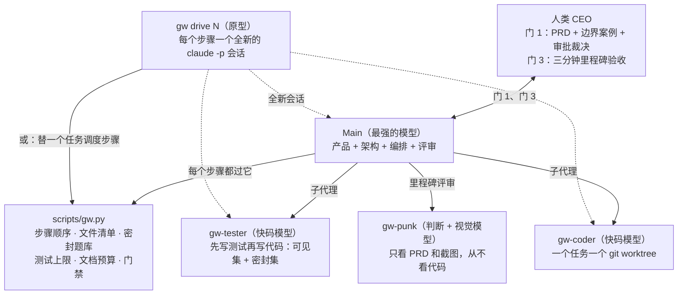

# graph-workflow（`gw`）

[](LICENSE)
[-green.svg)](scripts/gw.py)
[](CHANGELOG.md)
[English](README.md)

**给 AI 编码 agent 用的测试先行工作流：四个角色搭一张小图，凡是能机械检查的规则，全部交给脚本执行，而不是写在提示词里求模型自觉。**

## 先说结论

多 agent 搭伙写代码，翻车的方式就那么几种：PM 和架构师交接时把信息丢了；遇到模棱两可的产品问题，agent 不问你，自己拍板；程序员塞一堆没人要的防御代码；测试长成了实现的样子，该查的反而查不到；写在提示词里的规矩，终究斗不过模型长年养成的习惯。

`graph-workflow` 的解法是三件东西：

- **四个角色**——`Main`（产品、架构、编排、评审，全在一个会话里）、`Coder`（每个任务一个独立 worktree）、`Tester`（代码还没影就先写测试）、`Punk`（不看代码，专挑产品体验的刺）。
- **一个纯标准库的 Python 脚本** `scripts/gw.py`——步骤顺序、门禁、文件清单、测试上限、文档字数，全部由它拒绝，而不是由模型自觉。
- **一个脚本主导的编排器** `gw drive`——每个步骤开一个全新的会话，上下文不再滚雪球。

它被验证过两次：一次四路对照 benchmark，一次真实的三里程碑项目。但它不便宜——小项目上，时间是单人 agent 的十倍左右，测试量是五倍。动手之前，先看[什么时候别用](#什么时候别用)。

> **状态：v0.7，实验性。** v0.7 的修复全部来自第一次真实项目（见 research-notes §12），这些修复本身还没在下一个完整项目里重新跑过一遍。

## 目录

- [什么时候别用](#什么时候别用)
- [团队与拓扑](#团队与拓扑)
- [从真实构建里学到的五件事](#从真实构建里学到的五件事)
- [设计取舍](#设计取舍)
- [关键机制](#关键机制)
- [真实数据](#真实数据)
- [环境要求](#环境要求)
- [快速开始](#快速开始)
- [命令一览](#命令一览)
- [仓库内容](#仓库内容)

## 什么时候别用

- **小而薄的单屏项目。** Flow Timer 基准里，单人 agent 便宜十倍，正确率一样。如果你只从本仓库拿走两样东西，拿走 Gate 1 的边界案例清扫和 Punk 那一关。
- **三个文件都不到、也没有设计决策要拍。** 直接写，SKILL.md 里也是这么说的（Scaling → Down）。
- **没有 Git。** `gw` 离不开它。SKILL.md 里描述了一套手动兜底流程，但没有任何东西替你强制执行。

## 团队与拓扑

角色之间不靠自由聊天传话，靠有字数预算的文件。状态全部放在 Git 里的 `docs/workflow/` 下。



| 角色 | 谁 | 模型档位 | 能看到什么 | 产出什么 |
| :--- | :--- | :--- | :--- | :--- |
| **Main** | 你的会话（`gw drive` 下每个步骤一个全新会话） | 最强 | 主检出区里的一切 | 带边界案例和审批表的 `PRD.md`、`architecture.md`、`tasks.md`、任务简报、评审、门禁材料 |
| **Tester** | 子代理 [`gw-tester`](agents/gw-tester.md) | 快码 | 简报和测试约定，此时一行代码都还没有 | 可见测试、密封测试、带歧义清单的测试计划 |
| **Coder** | 子代理 [`gw-coder`](agents/gw-coder.md) | 快码 | 自己的 worktree `<repo>.gw/N/`：简报、允许改的文件、可见测试 | 代码 + 带 `## Defenses added` 的 `handoff-N.md` |
| **Punk** | 子代理 [`gw-punk`](agents/gw-punk.md) | 判断 + 视觉 | `PRD.md` 和浏览器里跑起来的产品（自己截图），永远不看源码 | 最多五条按优先级排的反对意见（`objections-M.md`，350 词） |
| **gw.py** | [`scripts/gw.py`](scripts/gw.py) | 无 | 主检出区、worktree、`~/.gw-vault/` | 拒绝、门禁结果、测试运行、合并、日志 |

档位说的是模型种类，不是排行榜。模型按部署环境自己挑；第二个模型家族最值得花在 Tester 或 Punk 身上。

## 从真实构建里学到的五件事

1. **规划只放在一个脑子里。** 产品、架构、编排、评审是同一个角色 `Main`，跑在一个会话里。子代理只干三件事：提供新眼光（`gw-tester`、`gw-punk`）、隔离 worktree 并行干活（`gw-coder`）、让大项目里 Main 的上下文别爆炸。
2. **模型会一声不吭地替你做决定。** Flow Timer 四路对照里，每一路（包括本工作流）都把四个埋好的边界案例自行拍板了，一个都没问人。四个碰巧答案一致，另外两个没明说的选择上又各走各的。所以现在 `gw gate 1` 会卡住任务简报：七个类别的边界案例表里，每一行争议都必须由人填上决定。
3. **提示词能压低防御性编码，评审才能除掉它。** 编码模型爱加没人要的状态标记、版本计数器、重试和反复重置。Coder 必须在 `## Defenses added` 下登记每一条防御；Main 评审时删掉任何说不出对应故障的防御。
4. **构建者看不见自己的产品。** 两路单人构建把六个常见 UX 毛病一个不落全犯了：破坏性操作没有确认、标签页标题不显示状态、文字对比度低于 WCAG AA、焦点不跳到新出现的提示、触控目标小于 44px、刷新丢工作。其中一路还自己截过图。`gw-punk` 从不读代码，只拿 PRD 和实时截图对着 `Always check` 清单逐项打勾。
5. **写在提示词里的规矩斗不过模型习惯，写在代码里的规矩能。** `gw.py` 机械强制：步骤顺序、Coder 的文件清单、逐字节一致的可见测试、密封题库、测试数量上限、文档预算、提交钩子预演、评审依据。

## 设计取舍

跟常见的多 agent 框架（LangGraph、CrewAI、AutoGen、MetaGPT）和纯提示词工作流技能（BMAD-METHOD、Superpowers、Spec-Kit）对照着看。每个项目都不同，参考时以对方最新文档为准。

| 问题 | 常见做法 | `graph-workflow` |
| :--- | :--- | :--- |
| 谁来执行流程 | 模型照着提示词自觉；或你自己写 agent 循环调 API | 编码 agent CLI + `gw.py`，越序、越界的步骤直接拒绝 |
| 角色怎么分 | 产品、架构、组长、开发各一个 agent | 一个 `Main` 管规划评审；三个窄子代理 |
| Coder 能作弊的测试 | coder 看得到、改得了整套测试 | 测试先行；密封集放仓库外；每套只用一次（`gw burn`） |
| 模糊的产品决策 | 一个可选的澄清环节 | 强制的边界案例表和审批表；`gw gate 1` 卡到人拍板为止 |
| 防御代码膨胀 | 交给评审 | `## Defenses added` 表格 + 评审里的过度防御审计 |
| UI 和胶水代码 | DOM mock，或干脆不测 | 纯函数核心 `step(state, event) -> (state, effects)` + 薄外壳，由 Punk 检验 |
| 文档体量 | 没有上限 | `gw docs`：记录文件只许表格，思考文件每标题 ≤ 3 句，字数预算（简报 350、交接 150），交接表每张最多三行 |
| 编排器上下文 | 整次构建越滚越大 | 一个任务一个会话；`gw drive` 每步开新会话 |

## 关键机制

### 1. 门 1：代码一行不写，先把边界案例和审批权定死

任何任务简报之前，Main 拿 PRD 的每条需求过七个类别（`gw.json` 里的 `edge_categories`）：

| 类别 | 问什么 |
| :--- | :--- |
| `threshold` | 恰好到、差一点、剩太少 |
| `interleave` | 状态走到一半又来了个动作：计数还继续吗 |
| `repeat` | 同一个动作连按两次、两个来源同时来 |
| `time-cross` | 一个窗口跨过另一个截止点 |
| `counting` | 什么算一次、什么不算 |
| `environment` | 刷新、午夜、多标签页、后台节流 |
| `failure` | 步骤做一半失败、存的数据坏了 |

有争议的进 PRD 的 `## Edge cases` 表，编号 `E1`、`E2`……附上选项和 Main 的建议，由人填 `Decision` 列。一个类别没争议就写一行 `- No dispute:`，所以这张表永远不会膨胀成「需求 × 类别」。v0.7 起 PRD 还多一张**审批表**（`approval_categories`：依赖、服务、发送、删除、生产）——这次构建能碰什么、花多少、发什么、删什么，门 1 之前由人定。`gw gate 1` 会拒绝：决策空着、来源不是 `CEO`、审批类别既没行也没 `Nothing needed`、缺 `gates/gate-0.md`；`gw brief` 在门 1 之前直接拒绝。事后发现的案例标成 `Main provisional`，`gw gate 3` 会一直等到人确认。

### 2. 先写测试，密封集只用一次（`gw planned`、`gw seal`、`gw holdout`、`gw burn`）

- **测试先行。** `gw-tester` 在 Coder 开工前，凭简报写出 `visible/` 和 `holdout/` 两套测试。
- **限量、可追溯。** `gw planned N` 数测试用例（`it(`、`test(`、`def test_`、`#[test]`、`func Test`，可配置），每条验收标准或边界案例最多 1 个可见测试 + 2 个密封测试；简报里每个边界案例必须有测试点名；把产品源码当文本读的测试直接拒绝。
- **一次性。** `gw seal N` 把密封集挪进仓库外的 `~/.gw-vault/`，只在跑测试时才进 worktree。跑挂了，`gw burn N` 把这套转成可见测试，Tester 再写一套新的。金库不是沙箱——「只用一次」才是让偷看变得没意义的东西。
- **纯 UI 任务不设密封集。** 第一次真实项目里，密封测试找到的缺陷是零，眼睛找到十四个。风险层只有 UI 的任务跳过密封集；只有当 `gw planned` 发现真有待审的东西时，规格检查会话才启动。

### 3. 编排成一个无头状态机

窗口生命周期、计时器、同步这类状态繁多的胶水代码：

- **核心：** `step(state, event) -> (state, effects)`，纯数据进出，时间以事件形式进来（`Tick(now)`）。Tester 用乱序、重复、交错的事件序列驱动它。
- **外壳：** 把操作系统或 DOM 的事实翻译成事件，效果一对一执行。外壳文件不许 import 状态类型；`gw check` 用 `shell_paths`（路径前缀）和 `shell_forbid`（正则）强制执行。外壳由 Punk 和人实际使用来检验。

### 4. 评审只能按简报判输；停车只能由 CEO 重启

- `gw review N fail "<ids>"` 必须点名：简报里的验收标准或边界案例编号、`check` 失败、或 `cheat`。别的统统记成 `deferred` 行，算通过。第一次真实项目里，有两个任务因为评审要求超出简报、连挂三次被停车，CEO 两次都翻了案。
- 停车的任务只有 `gw unpark N "<CEO 的话>" [state]` 能重启：回到停下的地方，或直接进 `review` 接受现状。绝不允许手改 `state.json`；CEO 的话会被记进日志。

### 5. 提交钩子在源头预演

一个只在 `gw merge` 里才炸的 pre-commit 钩子，代价是五个来回：修复要从合并点倒着传回 worktree、测试目录和金库。v0.7 起，`gw planned` 和 `gw check` 把文件暂存进主分支的一次性克隆，在那里跑仓库的 pre-commit 钩子，lint 或密钥扫描的问题直接送到 Tester 或 Coder 手上，什么都还没提交。仓库不会被写任何东西；克隆连同里面的内容整体删除。`gw.json` 里的 `commit_rehearsal`：`auto`（默认，只对带 `.pre-commit-config.yaml` 的仓库）、`true`、`false`。

### 6. 脚本主导的编排（`gw drive N`，原型）

v0.4 那次，Main 的上下文从 79k 涨到 410k token，累计 4070 万次缓存读取。`gw drive N` 把控制权倒过来：脚本按任务状态挑出下一步，为每一步开一个全新的 `claude -p --output-format json` 会话，只喂这一步的输入（简报 → 测试 → 规格检查 → 代码 → 评审 → 循环记录），中间夹着 `gw` 的门禁。Main 的会话以 `VERDICT: done | pass | fail | rerun-tester | stop` 收尾，每个会话的 token、费用和时长进 `log.md`。

v0.7 起支持队列（`gw drive N [N ...]`）；每次停车留下一页说明（`.gw/stop-N.md`：为什么停、谁来动、怎么续）；每个会话只干一件事；`gw hook [k]`（Claude Code 的 PreToolUse 钩子）拒绝上下文超过 k 千 token 的会话开新活。它先用假 CLI 端到端测过，又在真实项目的最后一个里程碑（七个任务）上跑过一次；详见 [references/drive.md](references/drive.md)。

## 真实数据

### Flow Timer 基准（v0.4）

同一个提示词——带怠速检测的专注计时器，埋了四个没明说的规格歧义——用四种方式各建一次。完整数字见 [research-notes §11](research-notes.md)。

| | v0.4 + Claude Code | v0.4 + Codex | 单人 + Claude Code | 单人 + Codex |
| :--- | :--- | :--- | :--- | :--- |
| 建完 | 是 | 一半不到 | 是 | 是 |
| 实际构建耗时 | ≈ 101 分钟 | — | ≈ 10 分钟 | 15 分钟 |
| 编排 token | 410k 峰值上下文，40.7M 缓存读取 | 48.1M 总量；审批评审 12.9M（145 次） | 161k 峰值，4.5M 缓存读取 | 1.1M 缓存读取 |
| 埋的案例问过人 | 0 / 4 | 0 / 4 | 0 / 4 | 0 / 4 |
| 埋的案例被测试钉住 | 4 / 4 | — | 2 / 4 | 2 / 4 |
| 六个常见 UX 毛病上线 | 4 个里 0 个（2 个没查） | — | 6 / 6 | 6 / 6 |
| 测试 : 产品代码（行） | ≈ 5 : 1（192 单元 + 17 e2e） | — | 0.8 : 1（49 单元） | 0.9 : 1（36 单元 + 12 e2e） |

**它没买到什么：** 一个更准的计时器。三条建完的线，四个埋点计时的结果一模一样。

**它买到了什么：** 每个埋点都有测试钉住、跳过要确认、离开要警告、标签页标题有状态、浏览器测试 17 个——代价是大约十倍的时间和五倍的测试量。

### 第一次真实项目 → v0.7（research-notes §12）

Claude Code 上一个数据看板的改版：三个里程碑，39 个任务。里程碑 1、2 是 Main 一个会话跑完的；里程碑 3（七个任务）用 `gw drive` 跑。

| | M1 | M2 | M3（`gw drive`） |
| :--- | :--- | :--- | :--- |
| 任务数 | 20 | 12 | 7 |
| 处理 token（96–98% 是缓存读取） | 649M | 185M | 186M |
| Main 占的比例 | 87% | 82% | 82% |
| Main 每次请求的上下文 | 514k | 277k | 会话内 299k，drive 步骤 80k |

这一趟教出来的事，以及 v0.7 的对应改法：

- **九次停车全是机械性的**——提交钩子、简报 Files 行上一个注释、drive 自身的毛病，没有一次需要人来拍板。v0.7 把每道门挪到出问题的人还来得及修的地方（上文机制 5）。
- **缺陷是眼睛找到的。** 里程碑的真实缺陷里：Punk 三轮找到十四个，密封测试找到零个。v0.7 给纯 UI 任务取消了密封集和规格检查。
- **drive 把自己的步骤压在 80k 上下文，可启动它的那个会话涨到了 519k。** v0.7 加了停车页、一个会话只干一件事、上下文钩子。
- **评审两次要求超出简报，CEO 两次翻案。** 现在评审输赢只看简报（上文机制 4）。
- **还没定：** 每个任务全量测试跑了三遍，里程碑里大约三个小时没有任何模型在工作（research-notes §12）。

## 环境要求

- Git，以及一个支持子代理的编码 agent CLI。在 Claude Code 上开发；v0.4 也在 Codex 上跑过。`gw drive` 目前仅限 Claude Code（参数对照 2.1.316 检查过）。
- Python 3.8+，只用标准库（在 3.13 上开发）。
- 仓库和它的兄弟目录别放在云同步盘上。
- Windows：`test_command` 在 cmd.exe 里执行。

## 快速开始

### 1. 把 skill 装在你的产品仓库外面

```bash
git clone https://github.com/Ramirez0291/graph-workflow.git ~/.claude/skills/graph-workflow
```

SKILL.md 里写了密封测试存放的位置，所以 skill 得住在你的个人技能目录，而不是 Coder 干活的仓库里。

### 2. 搭一个产品仓库

在仓库根目录：

```bash
# 生成 docs/workflow/gw.json、.gitignore 条目、兄弟目录 <repo>.gw/ 和 <repo>.tests/
python ~/.claude/skills/graph-workflow/scripts/gw.py init

# 六个常驻模板
cp ~/.claude/skills/graph-workflow/templates/{PRD,STATE,architecture,tasks,decisions,log}.md docs/workflow/

# 三个子代理（Claude Code；其他 harness 用各自的 agent 目录）
mkdir -p .claude/agents
cp ~/.claude/skills/graph-workflow/agents/gw-{coder,tester,punk}.md .claude/agents/
```

### 3. 填 `docs/workflow/gw.json`

`gw init` 会给每个键写入默认值；通常要改的是这几个：

```json
{
  "test_command": "npm test",
  "test_dir": "tests",
  "setup_command": "npm ci --prefer-offline",
  "registry_files": ["package.json", "src/index.ts"],
  "shell_paths": ["src/shell/"],
  "shell_forbid": ["from ['\"].*state", "import.*State"],
  "source_dirs": ["src"],
  "commit_rehearsal": "auto",
  "drive": {
    "models": {"main": "<最强的>", "coder": "<快码>", "tester": "<快码>"},
    "max_budget_usd": 5
  }
}
```

`shell_paths` 是路径前缀，不是 glob。`drive.models` 要设：不设的话，每个 `gw drive` 会话都跑在账户默认模型上。完整的键清单在 SKILL.md。

### 4. 开工

在仓库里对你的 agent 说「use graph workflow to plan <产品>」。Main 会先跟你面谈 PRD，扫边界案例和审批项，停下来等你填决策。过了门 1 之后，「continue」或「run the next task」驱动构建循环；Main 只会在门 3、停车任务或任何不可逆操作前再停一次。

## 命令一览

| 命令 | 阶段 | 干什么 |
| :--- | :--- | :--- |
| `gw init` | 初始化 | 写 `gw.json`、`.gitignore` 条目和兄弟目录 |
| `gw next` / `gw status` | 任意 | 每个任务的下一条命令 / 每个任务一行 |
| `gw gate 1` | A | 检查边界案例表、审批表和 `gates/gate-0.md`；解锁 `gw brief` |
| `gw brief N` | B | 章节、风险层、文件清单、页数预算、边界行逐字复制 |
| `gw planned N` | B | 测试集齐、测试上限、边界行有测试点名、禁止源码文本测试、提交钩子接受这些文件；可重跑 |
| `gw seal N` | B | 简报提交到 main；密封集和测试计划进金库 |
| `gw open N` | B | 开 worktree `<repo>.gw/N`，跑 setup 命令，放可见测试，设 `GW_SLOT` |
| `gw check N` | B | 文件清单、逐字节一致的可见测试、注册表文件、外壳规则、交接文档、提交钩子接受改动 |
| `gw finish N` | B | 评审通过 → 密封测试 → 从 main 刷新后合并 → 关闭，第一处失败就停 |
| `gw review N fail "ids"` · `gw burn N` | B | 打回循环；评审判负必须点名简报里的标准或边界行、`check` 或 `cheat`；跑挂的密封集转可见，重写一套新的 |
| `gw holdout N` · `gw merge N` · `gw close N` | B | `finish` 内部的步骤，一次一步；`close` 先拆链接，可重跑 |
| `gw park N` · `gw unpark N "why" [state]` | B | 停车等人；人的决定重启任务并记入日志 |
| `gw show N plan\|log` | B | 打印密封的计划或上次运行 |
| `gw drive N [N ...]` | B | 原型：按顺序跑各任务的循环，每步一个全新的 `claude -p` 会话；停车留一页在 `.gw/` |
| `gw try brief\|planned N` | B | 作者的自我检查：会拒绝什么，什么都不改 |
| `gw hook [k]` | 任意 | Claude Code PreToolUse 钩子：上下文超过 k 千 token 的会话不许开新活 |
| `gw gate 3 M<n>` | C | 任务全部关闭、没有临时边界行、没有悬而未决的审批、门禁材料和 Punk 报告齐、文档干净 |
| `gw archive M<n>` | C | 门 3 之后：把里程碑文件挪进 `docs/workflow/archive/M<n>/` |
| `gw docs` | 任意 | 记录/思考文件的规则、预算、布局、Punk 截图上限 |

## 仓库内容

- [`SKILL.md`](SKILL.md)：写给 Main 看的完整工作流。
- [`scripts/gw.py`](scripts/gw.py)：步骤状态机、门禁、金库、worktree、文档检查。
- [`scripts/drive.py`](scripts/drive.py) 和 [`references/drive.md`](references/drive.md)：`gw drive` 原型。
- [`tests/test_gw.py`](tests/test_gw.py)：在玩具仓库上配一个假 `claude` 的端到端检查；`python3 -m unittest discover -s tests`。
- [`agents/`](agents/)：[`gw-coder`](agents/gw-coder.md)、[`gw-tester`](agents/gw-tester.md)、[`gw-punk`](agents/gw-punk.md)。
- [`templates/`](templates/)：PRD、架构、任务、STATE、简报、交接、测试计划、反对意见、门禁材料、决策、日志；全部过 `gw docs`。
- [`references/failure-checklist.md`](references/failure-checklist.md)：基于 MAST 失败分类法（arXiv 2503.13657）的过关前检查清单。

## 相关文档

- [`CHANGELOG.md`](CHANGELOG.md)：每个版本一张「问题 → 改动」表。
- [`research-notes.md`](research-notes.md)：资料来源、决策记录、两次真实运行的事后复盘、benchmark 数字。

说到底，它做的不是让 agent 更聪明，而是让它们没法把没问过的问题偷偷替你答了。

## License

[MIT](LICENSE)
