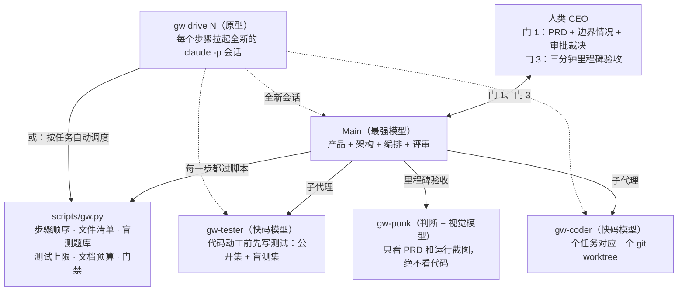

# graph-workflow（`gw`）

[](LICENSE)
[-green.svg)](scripts/gw.py)
[](CHANGELOG.md)
[English](README.md)

**给 AI 编码 agent 用的测试先行工作流：四个角色分工，凡是能用代码卡死的规矩，全部交给脚本拦截，不写在提示词里求模型自觉。**

## 太长不看

拉几个 agent 搭伙写代码，翻车来回就那么几种死法：PM 和架构师交接时把需求传丢了；遇到模棱两可的产品细节，agent 招呼都不打就替你拍了板；程序员往代码里塞一堆没人要的防御逻辑；测试完全顺着实现代码写，屁都测不出来；至于写在提示词里的千叮咛万嘱咐，跑不了几轮就会被模型原本的习惯带跑偏。

`graph-workflow` 用三样东西治这些毛病：

- **四个角色**：`Main`（产品、架构、编排、评审全在一个会话里包办）、`Coder`（每个任务在独立的 git worktree 里干活）、`Tester`（一行代码还没写的时候先把测试立好）、`Punk`（不看源码，专门在浏览器里挑产品体验的刺）。
- **一个只依赖标准库的 Python 脚本** `scripts/gw.py`：步骤顺序、门禁条件、允许改动的文件清单、测试数量上限、文档字数预算，违规直接报错拦截。
- **一个脚本主导的调度器** `gw drive`：每个步骤单独拉起一个全新的会话，上下文不再像滚雪球一样越攒越大。

这套流程经过两次实战检验：一次四路对照 benchmark，一次包含三个里程碑的真实项目。但它确实费钱费时间。做小项目时，耗时差不多是单 agent 的十倍，测试代码量是五倍。下手之前，建议先看一眼[什么时候别用](#什么时候别用)。

> **状态：v0.7，实验性。** v0.7 的改动全都来自第一个真实项目踩出来的坑（见 research-notes §12），这些补丁本身还没在下一个完整项目里从头到尾跑过一遍。

## 目录

- [什么时候别用](#什么时候别用)
- [团队与拓扑](#团队与拓扑)
- [从真实项目里踩出来的五条经验](#从真实项目里踩出来的五条经验)
- [设计取舍](#设计取舍)
- [关键机制](#关键机制)
- [实战数据](#实战数据)
- [环境要求](#环境要求)
- [快速开始](#快速开始)
- [命令一览](#命令一览)
- [仓库结构](#仓库结构)

## 什么时候别用

- **单屏就能装下的小项目。** 在 Flow Timer 基准测试里，单人 agent 便宜十倍，做出来的东西准确率没差。如果你只想从这个仓库里顺走两样东西，把 Gate 1 的边界情况排查表和 Punk 验收拿走就够了。
- **改动不到三个文件，也不涉及架构取舍。** 直接写就行，SKILL.md 里也是这么建议的（Scaling → Down）。
- **项目没用 Git。** `gw` 强依赖 Git。SKILL.md 里虽然写了手动兜底的法子，但没了脚本，所有规矩就又退化成靠自觉了。

## 团队与拓扑

角色之间不靠自由聊天传话，全靠限制了字数的文档交接。所有状态都躺在 Git 仓库的 `docs/workflow/` 目录下。



| 角色 | 运行方式 | 模型档位 | 可见范围 | 交付物 |
| :--- | :--- | :--- | :--- | :--- |
| **Main** | 主会话（`gw drive` 模式下每步开新会话） | 最强 | 主工作区的所有内容 | 带边界情况和审批表的 `PRD.md`、`architecture.md`、`tasks.md`、任务简报、代码评审、过门材料 |
| **Tester** | 子代理 [`gw-tester`](agents/gw-tester.md) | 快码 | 任务简报和测试规范（此时还没有任何业务代码） | 公开测试、盲测集、附带歧义清单的测试计划 |
| **Coder** | 子代理 [`gw-coder`](agents/gw-coder.md) | 快码 | 独立的 worktree `<repo>.gw/N/`：任务简报、白名单文件、公开测试 | 业务代码 + 包含 `## Defenses added` 的交接文档 `handoff-N.md` |
| **Punk** | 子代理 [`gw-punk`](agents/gw-punk.md) | 判断 + 视觉 | `PRD.md` 和浏览器里实际跑起来的产品（自己动手截图），不看源码 | 按优先级排好的最多五条挑刺意见（`objections-M.md`，限 350 词） |
| **gw.py** | [`scripts/gw.py`](scripts/gw.py) | 无 | 主工作区、worktree、`~/.gw-vault/` | 违规拦截、门禁判定、跑测试、合并分支、记日志 |

表里的「模型档位」指的是任务性质，不绑定特定厂商。具体用哪个模型看你手头的环境；如果条件允许引入第二家模型，优先换给 Tester 或 Punk，换个脑子挑刺效果最好。

## 从真实项目里踩出来的五条经验

1. **拿主意的只能有一个脑子。** 产品、架构、调度和评审全归 `Main` 管，放在同一个会话里。拉子代理出来只图三件事：换个没被污染的视角找茬（`gw-tester`、`gw-punk`）、在独立 worktree 里并行写代码（`gw-coder`），以及防止大项目把 Main 的上下文撑爆。
2. **模型遇到模糊地带，默认会替你自作主张。** 跑 Flow Timer 四路对照时，我们在需求里偷偷埋了四个没写清楚的边界情况。结果四路 agent（包括我们自己的 v0.4）全都一声不吭地自己拍了板，一个都没来问人。虽然那四个坑大家蒙的答案碰巧一样，但在另外两个没明说的细节上就各写各的了。所以现在 `gw gate 1` 会在发任务简报前直接卡死：七类边界情况表里，只要还有一行争议没由人类填上决定，流程就不准往下走。
3. **提示词只能少写点防御性代码，靠评审才能连根拔掉。** 写代码的模型特别喜欢顺手塞一堆没人要的状态标志、版本号计数器、重试逻辑和兜底重置。现在规矩改了：Coder 只要加了防御逻辑，就必须在交接文档的 `## Defenses added` 里逐条登记；Main 评审时挨个审，凡是说不出具体防哪种故障的，一律删掉。
4. **写代码的人看不出自己界面的毛病。** 两路单人 agent 写出来的东西，把六个常见的交互体验坑踩了个遍：删东西不弹窗确认、浏览器标签页标题不显示倒计时状态、文字对比度过不了 WCAG AA、新弹窗出现时焦点不跟过去、按钮点击热区小于 44px、一刷新页面进度全丢。甚至其中一路 agent 自己还截了图检查，照样视而不见。现在的 `gw-punk` 彻底不看源码，只拿 PRD 和实时截图，对着 `Always check` 清单一条条核对。
5. **写在提示词里的规矩管不住模型的手癖，只有写进代码的检查能管住。** 步骤顺序、Coder 允许碰的文件清单、公开测试不能改动一字节、盲测题库隔离、测试数量上限、文档字数限制、提交前钩子预演，现在全由 `gw.py` 硬性接管。

## 设计取舍

这里拿常见的多 agent 框架（LangGraph、CrewAI、AutoGen、MetaGPT）和纯提示词工作流（BMAD-METHOD、Superpowers、Spec-Kit）做个对比。各家工具迭代都快，具体特性以它们最新的官方文档为准。

| 问题 | 常见做法 | `graph-workflow` |
| :--- | :--- | :--- |
| 靠什么保证流程走对 | 指望模型听提示词的话；或者自己写套循环调 API | 编码 agent CLI 配合 `gw.py`，乱跳步骤或越界改文件直接报错退回 |
| 角色怎么切分 | 产品、架构、组长、开发各配一个 agent | 一个 `Main` 包揽规划和评审，配三个只干专活的子代理 |
| 防 Coder 针对测试作弊 | Coder 能看到甚至顺手改掉全套测试 | 测试先写；盲测集锁在仓库外面，且每套盲测只用一次（`gw burn`） |
| 需求里有模糊地带 | 设一个可选的提问环节 | 强制填边界情况表和审批表，`gw gate 1` 一直卡到人类拍板为止 |
| 防御性代码泛滥 | 留到代码评审时随缘挑 | 强制填写 `## Defenses added` 表，评审时专门做过度防御审计 |
| UI 和胶水层怎么测 | 写一堆 DOM mock，或者干脆放弃不测 | 核心逻辑写成纯函数 `step(state, event) -> (state, effects)`，外面套一层极薄的壳；壳交由 Punk 截图验收 |
| 文档越写越长 | 不设上限 | `gw docs` 硬卡：记录类文件只准用表格，思考类文件每个标题下最多三句话，简报限 350 词、交接限 150 词，交接表最多三行 |
| 调度器的上下文膨胀 | 整个项目从头到尾在同一个上下文里滚雪球 | 一个任务开一次会话；`gw drive` 模式下每走一步都换新会话 |

## 关键机制

### 1. Gate 1：一行代码没写之前，先把边界情况和审批红线定死

发任何任务简报之前，Main 必须拿 PRD 里的每条需求，去过一遍这七个问题类别（对应 `gw.json` 里的 `edge_categories`）：

| 类别 | 要问清楚什么 |
| :--- | :--- |
| `threshold` | 刚好卡在临界点、差一点才到、剩余量不够用时怎么办 |
| `interleave` | 状态走到一半插进来别的动作，原来的计时或计数还算不算 |
| `repeat` | 同一个按钮连点两下、或者两个地方同时发来请求怎么处理 |
| `time-cross` | 倒计时或时间窗口跨过了另一个截止时间怎么算 |
| `counting` | 到底什么情况算一次，什么情况不算 |
| `environment` | 刷新页面、跨过午夜十二点、开多个标签页、切后台被浏览器节流时怎么办 |
| `failure` | 步骤执行到一半挂了，或者本地存的数据坏了怎么恢复 |

凡是有争议的地方，全都要填进 PRD 的 `## Edge cases` 表，编上 `E1`、`E2`，列清楚备选方案和 Main 的建议，留着 `Decision` 那一列等人类来填。如果某个类别下没争议，就写一行 `- No dispute:` 占个位，免得整张表膨胀成「需求数 × 7」的巨型矩阵。

从 v0.7 开始，PRD 里还加了一张**审批表**（`approval_categories`：加依赖、调外部服务、发消息、删数据、动生产环境）。这趟构建到底允许碰哪些东西、花多少钱、发什么请求、删什么文件，全得在过门 1 之前由人定好。只要有决策空着没填、决策人不是 `CEO`、审批表里既没填内容也没写 `Nothing needed`，或者漏了 `gates/gate-0.md`，`gw gate 1` 就会直接打回；门 1 没过，`gw brief` 根本不让跑。如果写代码中途又冒出新的边界情况，会先标成 `Main provisional`，到了 `gw gate 3` 照样得停下来等人类追认。

### 2. 测试先行，盲测集只用一次（`gw planned`、`gw seal`、`gw holdout`、`gw burn`）

- **测试先行。** Coder 还没进场，`gw-tester` 就得先照着任务简报写出公开测试（`visible/`）和盲测集（`holdout/`）。
- **限额且可追溯。** `gw planned N` 会去数测试文件里的用例数（支持识别 `it(`、`test(`、`def test_`、`#[test]`、`func Test`，规则可配）。每条验收标准或边界情况，最多只准配 1 个公开测试和 2 个盲测；简报里列出的每个边界情况，都必须有对应的测试点名覆盖；任何把业务源码当纯文本读进来做正则匹配的凑数测试，直接打回。
- **盲测单次作废。** `gw seal N` 会把盲测集移到仓库外面的 `~/.gw-vault/` 目录锁起来，只有真跑测试的那一秒才放进 worktree。一旦盲测没跑过，`gw burn N` 会把这批暴露了的盲测降级成公开测试，再让 Tester 重新写一套新的盲测补进金库。金库本身防不住恶意偷看，真正让偷看失去意义的是「用过一次就作废」的机制。
- **纯 UI 任务不搞盲测。** 我们在第一个真实项目里发现，纯界面问题上盲测集抓到的 bug 数是零，反倒是肉眼看截图抓出了十四个。现在只要任务的风险层只有 UI，就不再折腾盲测集；只有当 `gw planned` 发现确实有逻辑待审时，才会拉起规格检查会话。

### 3. 把状态逻辑逼进无头状态机

遇到窗口生命周期、计时器、多端同步这种状态乱如麻的胶水代码，强制拆成两层：

- **纯函数核心：** `step(state, event) -> (state, effects)`，只管纯数据进出，连时间变化都当成普通事件传进去（比如 `Tick(now)`）。Tester 专门用乱序、重复点击、半路插队的事件序列去轰炸这个纯函数。
- **极薄的外壳：** 只管把操作系统或 DOM 里的变化翻译成事件喂给核心，再把核心吐出来的 effects 一对一执行掉。外壳文件里严禁 import 状态类型；`gw check` 会拿 `shell_paths`（路径前缀）和 `shell_forbid`（正则）去扫代码。外壳好不好使，交给 Punk 截图和人类实际上手去验。

### 4. 评审挂人必须对照简报；任务停摆只能由 CEO 放行

- 用 `gw review N fail "<ids>"` 打回代码时，必须给出明确理由：要么点出任务简报里哪条验收标准或边界编号没过，要么是 `check` 报错，要么是抓到了针对测试作弊（`cheat`）。超出简报范围的挑刺一律记进 `deferred` 留待以后再说，当前任务算通过。我们在第一个真实项目里吃过亏：当时有两个任务因为评审员提出了简报之外的要求，连续打回三次触发了自动停摆（park），最后两次都是人类 CEO 出面翻案。
- 一旦任务进入停摆状态，只有运行 `gw unpark N "<CEO 的决定>" [state]` 才能重启：要么退回停下的那一步重来，要么直接跳进 `review` 认下现状。严禁手动去改 `state.json`，CEO 给出的理由会原样记进日志。

### 5. 提交钩子在源头提前预演

如果仓库配了 pre-commit 钩子，等到最后合并分支（`gw merge`）时才爆出 lint 或密钥扫描错误，擦屁股的代价是来回折腾五步：得把报错从主分支倒推回 worktree、测试目录甚至盲测金库去改。

从 v0.7 开始，`gw planned` 和 `gw check` 会在主分支拉一个用完即删的临时克隆，把改动暂存进去提前跑一遍仓库的 pre-commit 钩子。有问题当场甩在 Tester 或 Coder 脸上，这时候连一次正式 commit 都还没发生。主仓库干干净净，临时克隆跑完直接删掉。这个行为由 `gw.json` 里的 `commit_rehearsal` 控制，可选 `auto`（默认，检测到 `.pre-commit-config.yaml` 就开）、`true` 或 `false`。

### 6. 脚本主导的调度（`gw drive N`，原型）

在 v0.4 跑测试时，Main 的上下文从 79k 一路膨胀到 410k token，攒下了 4070 万次缓存读取。`gw drive N` 把主次关系倒了过来：由 Python 脚本看着任务状态决定下一步干什么，每走一步就拉起一个全新的 `claude -p --output-format json` 会话，只喂当前这一步必需的材料（简报 → 写测试 → 查规格 → 写代码 → 评审 → 记循环日志），每步之间穿插 `gw` 的门禁检查。Main 会话结束时只吐出一句 `VERDICT: done | pass | fail | rerun-tester | stop`，这一步花了多少 token、多少钱、多少时间，全部自动记进 `log.md`。

v0.7 给它加上了队列支持（`gw drive N [N ...]`）；每次停摆都会在 `.gw/stop-N.md` 留下一张纸条，写清楚为什么停、该谁来处理、处理完怎么接着跑；保证每个会话只干一件事；另外还加了 `gw hook [k]`（Claude Code 的 PreToolUse 钩子），一旦发现当前会话的上下文超过 k 千 token，直接拒绝开启新任务。这套机制先拿假 CLI 跑通了端到端测试，随后在真实项目的最后一个里程碑（7 个任务）里实跑了一轮，细节见 [references/drive.md](references/drive.md)。

## 实战数据

### Flow Timer 基准测试（v0.4）

同一句需求提示词——做一个带闲置检测的专注计时器，里面故意埋了四个没写清楚的交互歧义——分别用四种配置从头建一遍。完整的统计数据在 [research-notes §11](research-notes.md)。

| 指标 | v0.4 + Claude Code | v0.4 + Codex | 单人 + Claude Code | 单人 + Codex |
| :--- | :--- | :--- | :--- | :--- |
| 有没有做完 | 做完了 | 卡在一半没跑完 | 做完了 | 做完了 |
| 实际耗时 | ≈ 101 分钟 | — | ≈ 10 分钟 | 15 分钟 |
| 消耗 token | 峰值上下文 410k，40.7M 缓存读取 | 总计 48.1M；光审批评审就烧了 12.9M（145 次） | 峰值 161k，4.5M 缓存读取 | 1.1M 缓存读取 |
| 埋好的 4 个歧义有几个问了人 | 0 / 4 | 0 / 4 | 0 / 4 | 0 / 4 |
| 埋好的 4 个歧义有几个写了测试锁死 | 4 / 4 | — | 2 / 4 | 2 / 4 |
| 6 个常见交互体验坑踩了几个 | 查了 4 项，0 踩坑（另 2 项当时没查） | — | 6 个全踩 | 6 个全踩 |
| 测试代码 : 业务代码（行数） | ≈ 5 : 1（192 单元 + 17 e2e） | — | 0.8 : 1（49 单元） | 0.9 : 1（36 单元 + 12 e2e） |

**多花十倍时间没换来什么：** 计时器本身并没有算得更准。跑通的三条线里，面对那四个埋好的歧义，大家算出来的时间分秒不差。

**多花十倍时间换来了什么：** 四个边界情况全都有测试锁死、跳过计时会弹窗确认、关页面前有未保存提醒、标签页标题会实时显示倒计时、多了 17 个浏览器端到端测试，以及把单人模式必踩的交互毛病全挡在了门外。代价就是十倍的时间和五倍的测试代码。

### 一个真实项目复盘 → v0.7（research-notes §12）

在 Claude Code 上重做一个数据看板项目，分三个里程碑，一共 39 个任务。前两个里程碑（M1、M2）是 Main 在单会话里扛下来的；第三个里程碑（M3，7 个任务）换成了 `gw drive` 调度。

| 指标 | M1 | M2 | M3（`gw drive`） |
| :--- | :--- | :--- | :--- |
| 任务数 | 20 | 12 | 7 |
| 处理 token 总量（96–98% 是缓存读取） | 649M | 185M | 186M |
| Main 消耗占比 | 87% | 82% | 82% |
| Main 单次请求平均上下文 | 514k | 277k | 会话内 299k，drive 单步 80k |

这趟项目暴露出的问题，直接变成了 v0.7 的改动：

- **九次中断停摆，居然没有一次是因为业务逻辑需要人拿主意。** 全是被提交钩子报错、简报 Files 行里多写了一句注释、或者 drive 脚本自己的 bug 给卡住的。v0.7 把所有机械检查都往前挪到了写代码和测试的源头，谁惹的祸当场自己修（见机制 5）。
- **界面上的 bug 全是靠眼睛看出来的。** 整个项目抓到的真实缺陷里，Punk 看截图三轮揪出了 14 个，而盲测集抓到的数量是 0。所以 v0.7 直接砍掉了纯 UI 任务的盲测集和规格审查。
- **drive 虽然把每一步的上下文压到了 80k，但负责启动它的外层主会话自己却肿到了 519k。** 为此 v0.7 补上了停摆说明页、单会话单任务限制，以及超长上下文拦截钩子。
- **代码评审有两次因为挑了简报之外的刺把任务挂掉，最后全被 CEO 翻案。** 现在规定评审挂人必须拿简报条款说事（见机制 4）。
- **还有一个坑没填上：** 每个任务在流程里把全量测试跑了足足三遍，整个里程碑算下来，有差不多三个小时的时间所有模型都在干等测试跑完（见 research-notes §12）。

## 环境要求

- Git，外加一个支持子代理的编码 agent CLI。这套工具是在 Claude Code 上写出来的；v0.4 版本也在 Codex 上跑过。`gw drive` 目前只支持 Claude Code（命令行参数已对照 2.1.316 版本核对）。
- Python 3.8+，只用标准库（开发用版本是 3.13）。
- 代码仓库以及它生成的同级目录（`.gw/`、`.tests/`）千万别放在 iCloud、OneDrive 这类云同步盘里，文件锁和同步延迟会把 worktree 搞乱。
- Windows 环境下，`test_command` 会在 `cmd.exe` 里执行。

## 快速开始

### 1. 把 skill 装在业务仓库外面

```bash
git clone [https://github.com/Ramirez0291/graph-workflow.git](https://github.com/Ramirez0291/graph-workflow.git) ~/.claude/skills/graph-workflow
```

因为 SKILL.md 里写明了盲测金库的存放路径，所以这套 skill 必须装在你的个人技能目录里，不能直接塞进 Coder 干活的业务仓库。

### 2. 初始化业务仓库

进到你的业务仓库根目录：

```bash
# 生成 docs/workflow/gw.json、写入 .gitignore，并在同级目录下创建 <repo>.gw/ 和 <repo>.tests/
python ~/.claude/skills/graph-workflow/scripts/gw.py init

# 拷入六个常驻文档模板
cp ~/.claude/skills/graph-workflow/templates/{PRD,STATE,architecture,tasks,decisions,log}.md docs/workflow/

# 拷入三个子代理配置（以 Claude Code 为例；其他工具放到各自对应的 agent 目录）
mkdir -p .claude/agents
cp ~/.claude/skills/graph-workflow/agents/gw-{coder,tester,punk}.md .claude/agents/
```

### 3. 配置 `docs/workflow/gw.json`

`gw init` 会生成带默认值的配置文件，平时顺手改一下这几项就行：

```json
{
  "test_command": "npm test",
  "test_dir": "tests",
  "setup_command": "npm ci --prefer-offline",
  "registry_files": ["package.json", "src/index.ts"],
  "shell_paths": ["src/shell/"],
  "shell_forbid": ["from ['\"].*state", "import.*State"],
  "source_dirs": ["src"],
  "commit_rehearsal": "auto",
  "drive": {
    "models": {"main": "<最强模型>", "coder": "<快码模型>", "tester": "<快码模型>"},
    "max_budget_usd": 5
  }
}
```

注意 `shell_paths` 填的是路径前缀，不支持 glob 通配符。如果打算用 `gw drive`，记得把 `drive.models` 填上；不填的话，拉起的所有会话都会默认跑在你账号的默认模型上。完整的配置项说明见 SKILL.md。

### 4. 开工

在仓库里对你的 agent 说一句：`use graph workflow to plan <你的产品>`。

Main 会先像产品经理一样找你聊需求写 PRD，扫一遍边界情况和审批项，然后停下来等你填决定。等你填好过了门 1，后面只需要说 `continue` 或者 `run the next task`，构建循环就会自己转起来；除非遇到门 3 验收、任务异常停摆、或者需要动不可逆的操作，否则 Main 中途不会再来烦你。

## 命令一览

| 命令 | 阶段 | 用途 |
| :--- | :--- | :--- |
| `gw init` | 初始化 | 生成 `gw.json`、更新 `.gitignore`，创建同级工作目录 |
| `gw next` / `gw status` | 任意 | 查看每个任务下一步该跑什么命令 / 单行汇总所有任务状态 |
| `gw gate 1` | A | 检查边界情况表、审批表和 `gates/gate-0.md`；通过后解锁 `gw brief` |
| `gw brief N` | B | 校验简报章节、风险层、文件清单、字数限制，确认边界情况原样照搬自 PRD |
| `gw planned N` | B | 检查测试文件齐全、数量没超标、边界情况全覆盖、无读取源码作弊，并预演提交钩子；支持重跑 |
| `gw seal N` | B | 把任务简报提交到 main 分支；把盲测集和测试计划锁进金库 |
| `gw open N` | B | 创建独立 worktree `<repo>.gw/N`，跑环境安装命令，放入公开测试，设置 `GW_SLOT` |
| `gw check N` | B | 校验改动未超出文件清单、公开测试一字节未改、注册表文件合规、外壳未越界、交接文档合规，并预演提交钩子 |
| `gw finish N` | B | 一键走完：评审通过 → 跑盲测 → 同步 main 分支并合并 → 清理关闭，中途哪步挂了就停在哪步 |
| `gw review N fail "ids"` · `gw burn N` | B | 打回重做循环；挂评审必须点名简报条款、`check` 或 `cheat`；跑挂的盲测转为公开测试，要求补写新盲测 |
| `gw holdout N` · `gw merge N` · `gw close N` | B | `finish` 命令拆出来的单步操作；`close` 会先断开链接，支持重复执行 |
| `gw park N` · `gw unpark N "why" [state]` | B | 挂起任务等待人类处理；填入人类决定后重启任务并记入日志 |
| `gw show N plan\|log` | B | 打印已锁入金库的测试计划或上一次运行日志 |
| `gw drive N [N ...]` | B | 原型：按顺序自动跑完任务循环，每一步拉起全新的 `claude -p` 会话；遇阻停摆时在 `.gw/` 下留说明纸条 |
| `gw try brief\|planned N` | B | 写完文档或测试后的自检命令：只挑刺报错，不改动任何状态 |
| `gw hook [k]` | 任意 | Claude Code 的 PreToolUse 钩子：一旦会话上下文超过 k 千 token，禁止开启新任务 |
| `gw gate 3 M<n>` | C | 里程碑验收检查：确认所有任务已关闭、无临时边界决定、无未决审批、验收材料与 Punk 报告齐全、文档格式合规 |
| `gw archive M<n>` | C | 过了门 3 之后，把当前里程碑的文档打包归档进 `docs/workflow/archive/M<n>/` |
| `gw docs` | 任意 | 检查记录类与思考类文档的格式、字数预算、目录结构以及 Punk 截图数量上限 |

## 仓库结构

- [`SKILL.md`](SKILL.md)：写给 Main 看的完整工作流说明书。
- [`scripts/gw.py`](scripts/gw.py)：状态机、门禁检查、盲测金库、worktree 管理与文档格式检查。
- [`scripts/drive.py`](scripts/drive.py) 与 [`references/drive.md`](references/drive.md)：`gw drive` 自动调度原型。
- [`tests/test_gw.py`](tests/test_gw.py)：用玩具仓库配合假 `claude` CLI 跑的端到端测试；运行方式：`python3 -m unittest discover -s tests`。
- [`agents/`](agents/)：三个子代理的提示词定义——[`gw-coder`](agents/gw-coder.md)、[`gw-tester`](agents/gw-tester.md)、[`gw-punk`](agents/gw-punk.md)。
- [`templates/`](templates/)：PRD、架构、任务、STATE、简报、交接、测试计划、挑刺报告、过门材料、决策、日志的空白模板，本身全部符合 `gw docs` 检查标准。
- [`references/failure-checklist.md`](references/failure-checklist.md)：参考 MAST 多智能体失败分类法（arXiv 2503.13657）整理的过关前自查清单。

## 相关文档

- [`CHANGELOG.md`](CHANGELOG.md)：按版本整理的「踩坑问题 → 对应改动」对照表。
- [`research-notes.md`](research-notes.md)：参考资料、设计决策记录、两次真实运行的事后复盘，以及完整的 benchmark 原始数据。

说白了，这套工具干的事情不是帮 agent 变聪明，而是把它的手捆住，省得它遇到没写清楚的需求时，背着你偷偷替你把主意拿了。

## License

[MIT](LICENSE)

## About me:

[Rami0291](https://rami0291.com)